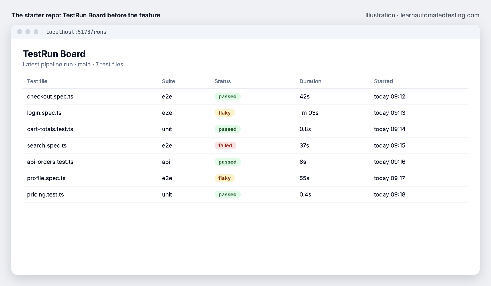

# TestRun Board

Example project for the course **[Agentic Engineering with Claude Code](https://learnautomatedtesting.com/courses/agentic-engineering-with-claude-code/)** on learnautomatedtesting.com.

TestRun Board is a small React + Vite + TypeScript dashboard that lists the test runs of the latest CI pipeline. The app is deliberately small. What matters is the setup around it: everything the course teaches is in this repository, so you can see it, run it and change it.



## Quick start

```bash
git clone https://github.com/learn-automated-testing/testrun-board.git
cd testrun-board
npm install                      # also installs the git pre-commit hook
npx playwright install chromium  # browser for the e2e tests
npm run dev                      # http://localhost:5173
npm run check                    # lint + typecheck + unit and component tests
```

There is no real backend: the API is served by [MSW](https://mswjs.io/) from `tests/mocks/handlers.ts`, the same handlers the tests use.

Then start your agent in the project folder: `claude` (or `opencode`). Claude Code asks once to approve the project MCP server (Playwright) and the hooks.

## What is where, and which lesson explains it

| Course topic | In this repository | Lesson |
|---|---|---|
| Context for every agent | `AGENTS.md` (shared), `CLAUDE.md` (imports it, plus Claude Code specifics) | 3, 11 |
| Tone of voice and conventions | "Communication" and "Writing in this repo" in `AGENTS.md` | 5 |
| Permissions: what the agent may do on its own | `permissions` in `.claude/settings.json` | 6 |
| Path-scoped rules | `.claude/rules/testing.md` (loaded for files in tests/) | 3, 7 |
| Skills | `.claude/skills/add-api-endpoint`, `.claude/skills/write-spec` | 7, 8 |
| MCP server | `.mcp.json` (Playwright MCP) | 9 |
| Failure modes and review | `docs/review-checklist.md` | 12 |
| Tests first | `tests/lib/`, `tests/runs-page.test.tsx`, fixtures in `tests/mocks/` | 13 |
| Subagent | `.claude/agents/test-reviewer.md` (read-only reviewer) | 14 |
| Hooks | `.claude/hooks/`: block dangerous commands, protect generated code, lint every edited file | 15 |
| Pre-commit and CI gates | `.githooks/pre-commit`, `.github/workflows/checks.yml` | 15, 17 |
| Agent policy in CI | `scripts/agent-policy.sh` | 17 |
| Specs | `docs/specs/` with a template and three feature specs | 20 |
| Property-based and mutation testing | `tests/lib/runs.property.test.ts`, `stryker.config.json` | 21 |
| Contract and generated code | `docs/api.yaml` → `npm run generate:api` → `src/generated/` | 8, 21 |
| Governance starter | `docs/agent-governance.md` | 21 |

## Commands

| Command | What it does |
|---|---|
| `npm run dev` | Dev server on http://localhost:5173 with the mock API |
| `npm test` | Unit and component tests (Vitest) |
| `npm run e2e` | Playwright end-to-end tests (starts the dev server) |
| `npm run check` | Lint + typecheck + tests; also runs as pre-commit hook |
| `npm run mutation` | Mutation testing with Stryker on `src/lib` |
| `npm run mutation:changed` | Mutation testing only on files changed against `origin/main` |
| `npm run generate:api` | Regenerate `src/generated/api-types.ts` from `docs/api.yaml` |

## Exercises and solutions

The `main` branch is the starting point. Exercises are described in [docs/exercises.md](docs/exercises.md). Where a lesson has a worked solution, it is on a branch:

| Branch | Lesson |
|---|---|
| `solution/lesson-02-status-filter` | 2. Build your first feature with an agent |

Compare your own result with a solution: `git diff main..solution/lesson-02-status-filter`.

## Requirements

- Node.js 22 or newer
- Claude Code or OpenCode, with at least a Claude Pro subscription or API access
